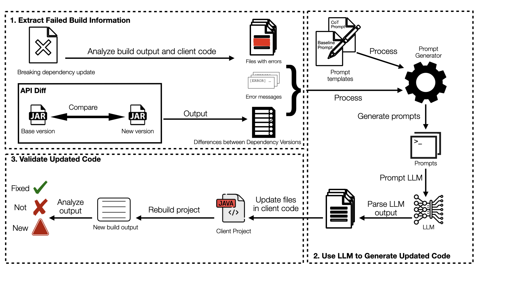

# Bacardi: Fixing Breaking Dependency updates with Large Language Models
Fix breaking dependency updates

If you use Bacardi, please cite:
```bib
@article{reyes_byam_2026,
	title = {Byam: {Fixing} {Breaking} {Dependency} {Updates} with {Large} {Language} {Models}},
	volume = {31},
	issn = {1573-7616},
	url = {https://doi.org/10.1007/s10664-026-10835-1},
	doi = {10.1007/s10664-026-10835-1},
	number = {4},
	journal = {Empirical Software Engineering},
	author = {Reyes, Frank and Mahmoud, May and Bono, Federico and Nadi, Sarah and Baudry, Benoit and Monperrus, Martin},
	month = apr,
	year = {2026},
	pages = {113},
}
```


## 🔧 Tool Architecture Overview

Bacardi automates the repair of breaking dependency updates through a three-step pipeline:
1. **Extract Failed Build Information**
2. **Use LLM to Generate Updated Code**
3. **Validate Updated Code**

The following diagram and module breakdown illustrate how the components interact across the system.

---

### 📌 Architectural Diagram


The diagram shows how build failures and API diffs flow through the system, how LLMs are invoked with prompt templates, and how fixes are validated in Apptainer builds.

---

### 🗂️ Module Structure

#### Step 1 — Extract Failed Build Information
- **[`git-manager`](git-manager):**  
  - Manages repositories and creates new branches for each failure category.
- **[`extractor`](extractor):**  
  - Extracts contextual information from the client’s repository and API diffs.
- **[`breaking-classifier`](breaking-classifier):**  
  - Classifies dependency-related failures and parses build logs.

#### Step 2 — Use LLM to Generate Updated Code
- **[`llm`](llm):**  
  - Connects to LLM providers (OpenAI, Google, Anthropic, OpenRouter) **or a local model**, resolved from `.env` (`LLM`, `LLM_TYPE`).
    
      Example
      ```env
      LLM=openai
      LLM_TYPE=gpt-4o-mini
- **[`prompts`](prompts):**  
  - Stores reusable prompt templates tailored to different failure scenarios.

#### Step 3 — Validate Updated Code
- **[`apptainer-build`](apptainer-build):**  
  - Builds reproducible [Apptainer](https://apptainer.org/) sandboxes (rootless, no daemon) to test and validate proposed fixes.
- **[`core`](core):**  
  - Manage the full workflow, manages configurations, and outputs logs and results to [`results/`](results/).

---

## Setup and Installation

To replicate the experiments, you need to set up the environment and build the project. Follow these steps:

1. Clone the repository:
   ```bash
   git clone git@github.com:chains-project/bacardi.git
   cd bacardi
    ```
2. Install [Apptainer](https://apptainer.org/docs/admin/main/installation.html) (replaces Docker — no daemon, runs rootless). Verify it's on your `PATH`:
   ```bash
   apptainer --version
   ```
   Writable sandboxes need `--fakeroot` support, which requires `subuid`/`subgid` entries for your user (a one-time host setup step — most distro packages configure this automatically; see the [Apptainer rootless docs](https://apptainer.org/docs/user/main/fakeroot.html) if `apptainer build --sandbox` fails with a permissions error).
3. Build the project:
   ```bash
   mvn clean install
   ```
4. Setup environment variable:
   ```bash
   cp .env.example .env
   ```

## Usage

Run the application using the following command:
```bash
    java -jar ./core/target/Bump.jar
```
### To execute a single breaking dependency update:

BACARDI can target and fix one breaking dependency update at a time.
Each case in the BUMP dataset is represented by a JSON record containing, among other fields, a `breaking_commit` hash. To repair just that one update:

1. Open the `.env` file.  
2. Add/replace the line below, replacing `<breaking_commit_hash>` with the exact value from the dataset’s JSON entry:
```bash
   SPECIFIC_FILE=<breaking_commit_hash>
````
You can find the `breaking_commit_hash` in the corresponding [`api-diff.txt`](results/api-diff.txt) file.

3. Run the application using the following command:
```bash
    java -jar ./core/target/Bump.jar
```
Only the specified commit will be processed.

---
### LLM configuration and selection 

Bacardi is designed to work flexibly with multiple **Large Language Models (LLMs)**, either cloud-hosted or run **locally** on your own hardware.
It does **not** run on all LLMs by default.

### 🔧 How to Select an LLM

You can control which LLM is used via these environment variables in your `.env` file:

| Variable                                            | Description                                                        | Example                                                                                                            |
|-----------------------------------------------------|--------------------------------------------------------------------|--------------------------------------------------------------------------------------------------------------------|
| `LLM`                                               | Name of the model to use                                           | `gpt-4o-mini`, `gemini-2.0-flash-001`, `o3-mini-2025-01-31`, `deepseek-deepseek-chat`, `qwen-qwen2.5-32b-instruct`, `unsloth/gemma-3-12b-it-unsloth-bnb-4bit` |
| `LLM_TYPE`                                          | Type of inference provider                                         | `openai`, `openrouter`, `google`, `anthropic`, `local`                                                             |
| `OPENROUTER_PROVIDER` *(optional)*                  | If using [OpenRouter](https://openrouter.ai), specify the provider | `open-inference/bf16`, `chutes/fp8`                                                                                |
| `API_KEY` / `GOOGLE_API_KEY` / `OPENROUTER_API_KEY` | API keys for the cloud providers                                   | `your-api-key-here`                                                                                                |
| `LOCAL_LLM_BASE_URL` *(only for `LLM_TYPE=local`)*  | Base URL of your local inference server — **no API key needed**    | `http://localhost:8001/v1`                                                                                        |

Bacardi currently supports these five cloud models, each running with their respective inference providers:

- **gpt-4o-mini** *(OpenAI)*
- **o3-mini-2025-01-31** *(OpenAI)*
- **gemini-2.0-flash-001** *(Google)*
- **deepseek-deepseek-chat** *(via OpenRouter)*
- **qwen-qwen2.5-32b-instruct** *(via OpenRouter)*

> ❗ **Important**:
> 
>Bacardi <span style="color: red; font-weight: bold;">does not</span> automatically run on all models. You must configure the desired one before execution.
>
> Only the configured LLM will be used when running the repair pipeline.
>

#### Running a local model (no API key required)

Set `LLM_TYPE=local` to route generation to your own machine instead of a paid API. Bacardi talks to it over a plain HTTP endpoint, so it works with any OpenAI-compatible local server (Ollama, llama.cpp server, vLLM, text-generation-webui) — including a locally-loaded **Unsloth 4-bit model**, for which this repo ships a ready-to-use server:

1. Start the local server once and leave it running (loads the model into memory a single time — see [`llm/local_server/serve_unsloth.py`](llm/local_server/serve_unsloth.py)):
   ```bash
   pip install unsloth torch transformers fastapi uvicorn
   python3 llm/local_server/serve_unsloth.py --model unsloth/gemma-3-12b-it-unsloth-bnb-4bit --port 8001
   ```
2. Configure `.env`:
   ```env
   LLM_TYPE=local
   LLM=unsloth/gemma-3-12b-it-unsloth-bnb-4bit
   LOCAL_LLM_BASE_URL=http://localhost:8001/v1
   ```
3. Run Bacardi as usual — no `API_KEY`/`ANTHROPIC_API_KEY`/`GOOGLE_API_KEY`/`OPENROUTER_API_KEY` needed.

---
## Results
The results of the experiments are stored in the [results](results) directory. Each experiment is organized into subdirectories, containing the following files:
- `results_<prompt_name>`: Contains the results of the experiment for a specific prompt.
- `<model_n>`: Contains the results for a specific model.
```
📁 results
├── 📁 results_<prompt_name> each prompt results
│   ├── 📁 <model_n> model results
│   ├── -----
│   ├── 📁 <model_n> model results
```

---

## License

This project is licensed under the [MIT License](LICENSE).

---

Thank you for using **Bacardi**! If you encounter any issues or have feedback, feel free to create an [issue](https://github.com/chains-project/bacardi/issues).
